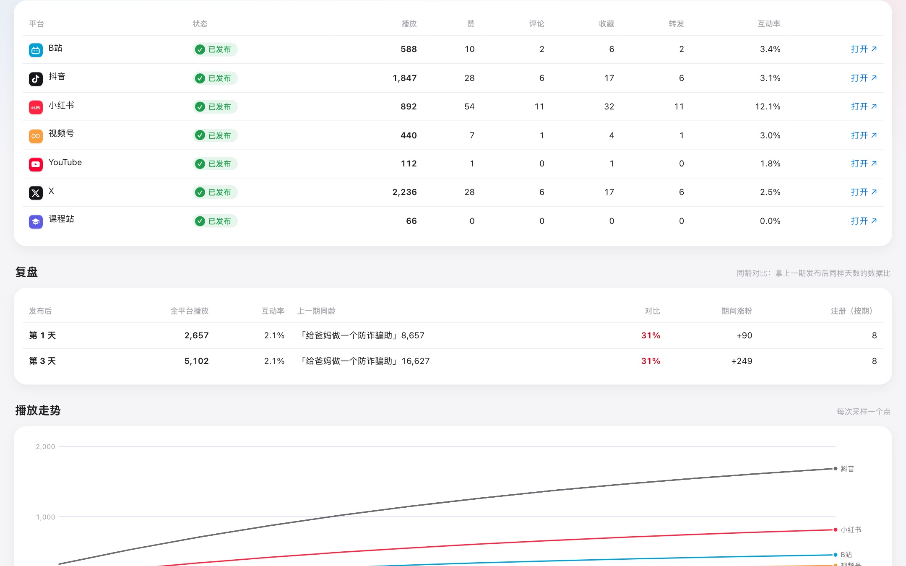
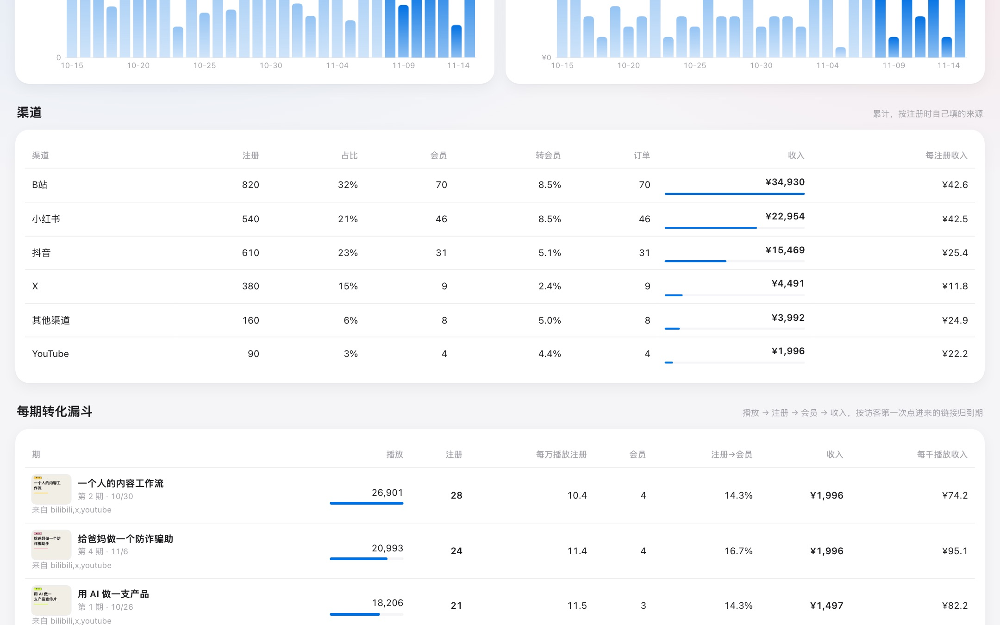

# 麦田 · mdldm-maitian

**给多平台博主的开源工作台：发得出去、看得清楚、算得出钱。**

1. **多平台分发 + 定时**：一期视频分批填好 B站、抖音、小红书、视频号、YouTube、X，提前排进「分发计划」，到点发布、自动取链接。
2. **多平台数据监控与留存**：每期在每个平台的播放、互动，各平台粉丝，每天自动采、长期留存；手机上看大屏，飞书群推卡片。
3. **打通你自己的站点，看转化**：哪一期、哪个平台带来了注册和收入。麦田留好了接口，接入你自己的站点后在上面二次开发即可（作者用自己的课程站做了示例）。

> 作者在用它发「我看谁不学 Grok Bot」等系列视频。它跑在一台常开的 Mac 上，用你自己登录好的浏览器操作各平台，**不存任何平台密码**。

<p align="center"></p>
<p align="center"><sub>大屏（演示数据，<code>node src/demo.mjs</code> 就能看到）</sub></p>

| 日历：分发计划 | 单期复盘：同龄对比 | 每期转化漏斗 |
|---|---|---|
|  |  |  |

## 工作台由哪几部分组成

| 部分 | 做什么 | 在哪 |
|---|---|---|
| 发布 skill | 让 AI 助手（Claude Code / Codex）看片、写各平台文案、生成发布工程并校验 | 本仓库 [`skills/maitian-publish`](skills/maitian-publish/SKILL.md) |
| 麦田发布助手 | Chrome 插件，各平台适配器：打开上传页、传视频和封面、填文案、设定时 | [mdldm-maitian-publisher](https://github.com/CzzzzzzJ/mdldm-maitian-publisher) |
| 麦田（本仓库） | 分发计划、调度、防重、等你点发布、取链接、采数据、网页大屏、飞书通知 | 本仓库 |

链路：成片 → skill 写「发布素材.md」→ 生成 `publish.json` → `hub plan` 进分发计划 → `hub run` 分批填写 → 国内平台你点发布 → 到点取链接 → 每天采数据 → 大屏和飞书卡片。

## 三级上手

| 级别 | 你能得到 | 要装的 | 大概时间 |
|---|---|---|---|
| L1 只看数据 | 各平台粉丝、已发作品的播放互动、大屏、飞书日报 | 麦田；专用 Chrome 里登录各平台；已发的期用 `hub adopt` 登记 | 30 分钟 |
| L2 分发 | 一期一次填好六个平台，定时，自动取链接 | + 麦田发布助手；+ 发布 skill（或手写 `publish.json`） | 再 1 小时 |
| L3 转化 | 每期带来的注册和收入 | + 你自己的站点按 `src/site.mjs` 的接口接入 | 看站点 |

## 它做什么

- **播种（发布）**：读 NAS 上的一期发布工程（成片、封面、各平台文案、定时），按批次在专用 Chrome 里填好各平台上传页。
  - X、YouTube、自有站点：回读文案和定时一致后自动提交，只点一次。
  - B站、抖音、小红书、视频号：**填好就停**，等你自己点「发布 / 定时发布」，守护进程每 20 分钟提醒。
  - 防重：库里已经到位的平台不再跑；X 定时列表、YouTube Studio、站点后台已有同名的不再传。
- **长势（流量和粉丝）**：每天上午采一次各期在各平台的播放和互动、各平台粉丝数；新一期头三天每 6 小时采一次。
- **收成（转化，可选）**：接上自有站点后，看注册、会员、订单、收入从哪个渠道、哪一期来。
- **日历**：上周到未来两周，已发布、已定时、等你点、计划中的期一眼看清。
- **粮仓（档案）**：每期的封面、文案快照、各平台链接、过程日志。
- **复盘（数据分析）**：每期发布后第 1/3/7 天自动出复盘卡片：各平台占比、互动率、和上一期同龄对比（第 N 天对第 N 天）、期间涨粉、带来的注册；每周一出周报。网页单期页有同一份复盘表，转化页有每期转化漏斗（播放 → 注册 → 会员 → 收入）。
- **飞书通知**：开跑、每个平台到位、异常、等你点发布、定时被平台改掉、每日日报、复盘和周报，都是带颜色的卡片。

## 架构

```
            ┌────────────── Mac（常开）──────────────┐
NAS 发布工程 │  hub.mjs 守护进程 ──── 专用 Chrome（CDP 9333）── 各平台创作者后台
publish.json ─▶│     │  ▲                 ▲                       │
成片/封面     │     │  │ 平台适配器（麦田发布助手 lib/）       │
            │     ▼  │                                          │
            │  SQLite（data/hub.db） ── web.mjs（麦田网页 :8787）── 手机/电脑（可选 Cloudflare 隧道）
            │     │                                              │
            │     └── feishu.mjs ──▶ 飞书群机器人（卡片通知）       │
            └───────────────────────────────────────────────┘
```

- 平台填写逻辑在姊妹仓库 [麦田发布助手 mdldm-maitian-publisher](https://github.com/CzzzzzzJ/mdldm-maitian-publisher)（Chrome 插件）里，麦田直接加载它的 `lib/`，适配器只维护一份。`src/chrome-shim.mjs` 在 Node 里模拟插件需要的 `chrome.tabs` / `chrome.debugger`。
- 发布工程 `publish.json` 由插件仓库的 `tools/make-publish.mjs` 从一份 Markdown 发布素材生成，`tools/validate.mjs` 校验（字数、禁词、封面比例、成片 faststart 等）。

## 安装

一行装好（下载麦田和发布助手到 `~/maitian/`、接上发布 skill、打开安装向导）：

```bash
bash -c "$(curl -fsSL https://raw.githubusercontent.com/CzzzzzzJ/mdldm-maitian/main/scripts/install.sh)"
```

或者手动：

需要：macOS、Node.js ≥ 22.5（用到内置 `node:sqlite`）、Google Chrome；可选 NAS（放成片）、飞书群机器人、cloudflared。

```bash
git clone https://github.com/CzzzzzzJ/mdldm-maitian-publisher.git
git clone https://github.com/CzzzzzzJ/mdldm-maitian.git && cd mdldm-maitian
node src/demo.mjs                       # 先用假数据看看效果：http://localhost:8788/?key=demo
node src/init.mjs                       # 安装向导：检查环境、生成 config.json、装开机自启、打开各平台登录页
node src/hub.mjs doctor                 # 登录完检查各平台登录态和上传页（不上传、不填写）
```

打开向导最后给出的地址（`http://localhost:8787/?key=<web.key>`），之后浏览器会记住口令。手动安装也可以：`cp config.example.json config.json` 填好后跑 `scripts/install-launchd.sh`。

## 命令

```bash
node src/hub.mjs plan [工程目录]            # 登记进分发计划（不带目录 = 扫描 rootPath）
node src/hub.mjs run <工程目录> [--only x,zsz] [--force] [--now]   # 发一期；--now 让站点课程立即上线（默认推迟到定时前 30 分钟）
node src/hub.mjs status [id] [--logs]
node src/hub.mjs sync <id> [--only a,b]     # 取链接，写 发布记录.json，回填发布素材 md 的「已发布」行
node src/hub.mjs mark <id> <平台> <状态> [备注] [--url 链接]   # 手动改状态（平台认不出时用）
node src/hub.mjs adopt <工程目录>            # 登记一期已经发过的（不上传），按标题取链接
node src/hub.mjs metrics [id]               # 采流量并发日报
node src/hub.mjs followers                  # 采粉丝
node src/hub.mjs review <id> [天数] [--notify]   # 看某期发布 N 天的复盘（守护进程会在第 1/3/7 天自动发）
node src/hub.mjs weekly [--notify]          # 上周周报（守护进程每周一自动发）
node src/hub.mjs board                      # 同步到飞书多维表格（可选）
node src/hub.mjs daemon                     # 常驻（install-launchd.sh 装的就是它）
```

## 配置要点（`config.json`）

| 项 | 说明 |
|---|---|
| `pluginDir` | 麦田发布助手（mdldm-maitian-publisher）的本地路径 |
| `rootPath` / `nasUrl` | 发布工程根目录；NAS 掉线或被挂到「…-1」时守护进程会自己卸掉重挂 |
| `batches` | 上传批次。一次传太多平台会互相抢带宽导致超时，建议国内两两一批 |
| `auto` / `manual` | 自动提交 / 等你点发布的平台 |
| `keepAlive` | 容易掉登录的平台（视频号），定时刷一下保活 |
| `site` | 自有站点，可选，见下 |
| `board` | 飞书多维表格看板，可选 |
| `web.key` | 网页口令，所有页面和接口没有口令一律 401 |

## 接入你自己的站点（可选，二次开发）

不配 `config.site` 就整块关掉，网页上也不显示站点卡片和「转化」页。要看转化：

1. 发布 skill 会在 B站、YouTube、X 的链接上带 `utm_campaign=<主题>-<序号>`；你的站点记下访客第一次带来的这个参数，注册和下单时一起存。
2. 站点提供两个只读接口给麦田（用专用 Chrome 里的管理员登录态去调），字段见 [`src/site.mjs`](src/site.mjs) 顶部注释。
3. 在 `config.site` 里填站点地址和接口路径。

作者用自己的课程站做了示例；你的站结构不同，改 `src/site.mjs` 和转化页即可。

## X 长文 + 视频帖引用长文（可选）

发布素材「八、X」里加一行 `**长文：** https://x.com/compose/articles/edit/<id>`（先在 X 建好长文草稿，可用发布助手的 `tools/article.mjs` 把 Obsidian 笔记写进去），生成的 `publish.json` 里 X 会是 `"mode": "article+quote"`。麦田在定时前 25 分钟启动发布助手的 `tools/x-article-quote.mjs`：先上传视频帖，到点发布长文，取到长文链接后贴进视频帖变成引用再发出，结果推飞书。这一步用的是日常 Chrome 里装的发布助手（开发桥 127.0.0.1:8765）。

## 各平台的坑（实战总结）

- **国内四家由你自己点最终发布**。自动化只负责填写和核对，最后一下人点，降低风控风险。
- **小红书只走最保守的路**：只读页面上已经渲染的内容、像人一样滚动和点击，不在页面里直接调它的接口，低频。
- **同一条视频每个平台只上传一次**，反复重传最容易触发风控；中控的防重就是为这个。
- **视频号的定时可能被改**：表单回读是对的，提交后平台记成别的时间（遇到过 +2 小时）。`sync` 会拿平台记录的定时和计划比对，不一致发 ⚠️ 卡片。
- **YouTube 上传对话框被关掉**时，视频可能已经排好定时；中控会先查 Studio 列表再下结论。
- **成片必须 faststart**（moov 在文件头），否则小红书报「无视频流信息」、抖音不出表单；校验会拦。
- **专用 Chrome 卡死**：用 `curl 127.0.0.1:9333/json/close/<id>` 关掉卡住的标签页，不会触发「离开此网站」确认。

## 远程访问（可选）

`scripts/install-launchd.sh --tunnel` 会装一个 cloudflared 快速隧道，把 8787 映射成 `https://xxx.trycloudflare.com`，地址变了推飞书。快速隧道重启后地址会变；要固定域名用 Cloudflare 命名隧道。

## 数据和隐私

- `config.json`、`data/`（数据库、日志）、`chrome-profile/`（各平台登录态）都不进 git。
- 麦田只读你自己账号的创作者后台数据，不做互动自动化、不碰别人的账号。

## License

MIT
